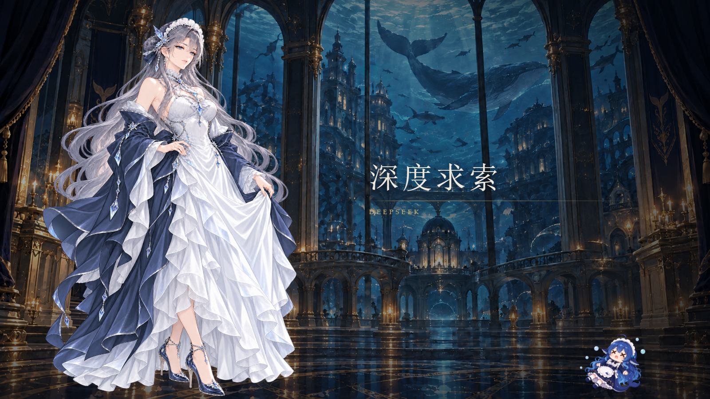

# 深度求索开场 · dsh-boot

深海起幕，鲸鱼女仆从容登场。

为 DeepSeek Harness（DSH）制作的开场动画：深蓝宫殿、银发御姐与蓝白长裙，配上一位俏皮的蓝发 Q 版助手。“深度求索”四字缓缓显现，舞台渐隐后进入工作界面。点击画面或按 Esc，随时跳过。

A deep-sea whale-maid startup animation for DeepSeek Harness. Click or press Esc to skip.



上图使用正式动画代码和真实素材，在独立浏览器中截图；不是占位图。最新版安装后的 DSH 开机画面仍待完整重启复核。

## 下载与安装

版本 **0.3.1**，包名已由 `dsh-plugin-boot-whale-maid` 精简为 **`dsh-boot`**。开场标题仍为“深度求索”，英文副标题为 DEEPSEEK。本版将蓝发 Q 版图片随包携带，只安装本插件即可显示，无需另外安装 maid-atelier 皮肤。

从 [GitHub Releases](https://github.com/Ian-Yunqi/dsh-plugin-boot-whale-maid/releases) 下载 `dsh-boot-0.3.1.tgz`，然后运行：

```bash
dsh plugin --profile desktop add ./dsh-boot-0.3.1.tgz
```

安装后完整退出并重新打开 DSH。如果使用其他 profile，请把 desktop 换成对应名称。GitHub 仓库地址暂沿用旧名以保留已有链接；没有发布到 npm，安装时请使用下载的 tgz 文件。

从旧包升级前，先备份 profile 的 package.json、锁文件和配置。将启用的 bundles 中的旧包名移除，再安装新包；若 cordis.yml 中有旧包的直接加载行，也应移除。两者只保留一个开场插件。用户自己的 cordis.patch.yml 配置应保留。

## 画面与节奏

- 主立绘和无文字宫殿随包安装；长鹅蛋脸、沉静蓝眼、冷白长裙与深靛蓝垂袖。
- 原蓝发 Q 版以未修改的原图随包安装，不再依赖用户本机的原皮肤包。窗口内容区域宽度 ≤720px 或高度 <520px 时，为避免拥挤仍会隐藏 Q 版；放大窗口后重新启动开场即可。
- 素材准备完成后播放 9.6 秒；最后 1.2 秒渐出。点击或 Esc 立即清理舞台。
- 系统开启“减少动态效果”时显示 2.6 秒静态开场，保留人物，不播放幕布与粒子运动。
- 主立绘或宫殿加载失败会撤掉遮罩，使用简短标题降级，避免挡住工作界面。

## 验证与开发经验

源码分为宿主 ESM 与 DSH 客户端经典脚本。客户端源文件是 `lib/client.js`，发布入口是构建生成的 `lib/client.dsh.js`。

```bash
node scripts/build-client.mjs --check
node scripts/check-client-format.mjs
node scripts/smoke.mjs
node scripts/assert.mjs
node scripts/check-artwork.mjs
```

验证应在最终 tgz 解包后重跑。假 DOM 检查时间线和清理行为，浏览器预览检查真实素材与构图，DSH 重启检查实际加载；这些结论分别记录，不互相替代。

完整复盘见 [开发经验](docs/LESSONS.md)，短包名升级见 [迁移说明](docs/MIGRATION.md)。技术包名已经精简，CSS、素材路由和开场握手的内部标识保留以减少无关变化。

## 素材与许可

代码采用 MIT。主立绘、宫殿为本项目通过内置 imagegen 生成和编辑的素材；参考图来源尚未完整确认，不宣称对参考图或相关角色拥有独占权利。随包分发的原 Q 版保留上善 → ZipZipPipe → Small-tailqwq 的署名与 CC BY-NC-SA 4.0 条件；原图字节未经修改。包含原 Q 版的预览截图遵循同一署名、非商业与相同方式共享条件。

详见 [LICENSE](LICENSE)、[素材署名](docs/ATTRIBUTION.md)、[美术许可全文](LICENSE-ARTWORK) 和 [上游署名原文](docs/UPSTREAM-NOTICE)。
